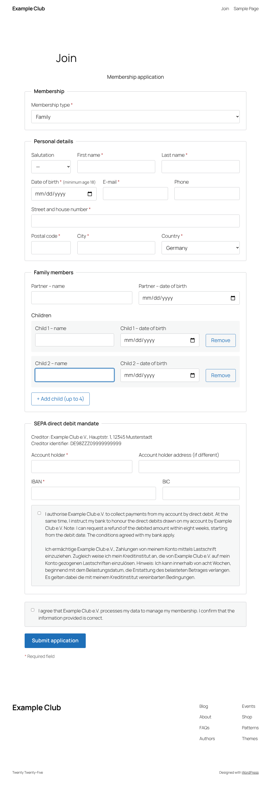
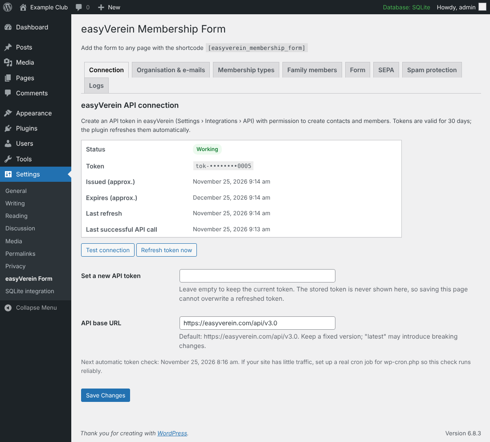

# easyVerein Membership Form for WordPress — API v3.0

[](https://wordpress.org)
[](https://www.php.net)
[](https://easyverein.com/api/v3.0/documentation)
[](LICENSE)

A WordPress plugin that adds a membership application form to your website and creates the application directly in [easyVerein](https://easyverein.com) through the **easyVerein REST API v3.0**.

It is also meant as a **reference implementation** for anyone building their own easyVerein integration in PHP. It shows how to:

- talk to API **v3.0**, with snake_case fields and the standalone assignment endpoints;
- keep the **30-day token** alive with automatic, race-safe refresh;
- handle errors without losing applicants;
- process personal and bank data with privacy in mind.

> **Unofficial.** This project is not affiliated with or endorsed by SD Software-Design GmbH, the maker of easyVerein.

| Membership form | Settings › Connection |
| --- | --- |
|  |  |

---

## Table of contents

1. [Features](#features)
2. [Requirements](#requirements)
3. [Installation](#installation)
4. [Configuration reference](#configuration-reference)
5. [How an application is created](#how-an-application-is-created)
6. [Token lifecycle and automatic refresh](#token-lifecycle-and-automatic-refresh)
7. [Error handling](#error-handling)
8. [Customising: templates, styles, hooks](#customising)
9. [Architecture](#architecture)
10. [Data stored in WordPress](#data-stored-in-wordpress)
11. [Security and privacy](#security-and-privacy)
12. [Troubleshooting](#troubleshooting)
13. [Testing](#testing)
14. [Known limitations](#known-limitations)
15. [Contributing](#contributing)
16. [References](#references)
17. [License](#license)

---

## Features

| Area | What you get |
| --- | --- |
| **easyVerein API v3.0** | snake_case payloads; `member-group-assignment` and `member-custom-field-assignment` endpoints; the `token_refresh_needed` header |
| **Token handling** | Token stored outside the settings form; refresh triggered by the API header; proactive refresh by WP-Cron; DB lock against parallel refreshes; one retry on 401 after a concurrent rotation; admin e-mail and dashboard notice when the token is rejected |
| **Membership types** | Any number of types, each mapped to an easyVerein member group; optional display fee; "family" flag |
| **Family memberships** | Partner plus up to 10 children, stored in easyVerein custom fields |
| **SEPA direct debit** | Optional mandate section with creditor ID, standard German/English mandate text, IBAN mod-97 checksum, optional BIC |
| **Spam protection** | Honeypot and signed minimum-fill-time token (always on); Google reCAPTCHA v2 (optional) |
| **E-mails** | Confirmation to the applicant; notification to the organisation, including failed attempts; IBAN masked |
| **UX** | Post/Redirect/Get (no double submissions); inline errors; entered values kept on errors; accessible markup; responsive layout |
| **Privacy** | Logs in a protected uploads folder with a random file name; personal data masked in logs |
| **Extensibility** | Theme-overridable templates; filters for every payload; actions after creation and refresh |
| **i18n** | Translation ready; `languages/easyverein-membership-form.pot` included |

## Requirements

- WordPress **5.6+**
- PHP **7.4+** (tested on 7.4-compatible syntax and PHP 8.3)
- An easyVerein plan with API access, and an API token that may create contact details and members
- Outgoing HTTPS from your server to `easyverein.com`
- Working WordPress e-mail (an SMTP plugin is recommended)

## Installation

1. **Install the plugin.** Either:
   - upload the release ZIP under *Plugins › Add New › Upload Plugin*, or
   - clone the repository:
     ```bash
     cd wp-content/plugins
     git clone https://github.com/your-github-user/easyverein-membership-form.git
     ```
2. **Activate** *easyVerein Membership Form*.
3. **Create an API token in easyVerein** (*Integrationen › easyVerein API*). Give it permission to create contact details and members.
4. Open *Settings › easyVerein Form › Connection*. Paste the token into **Set a new API token**, click **Save Changes**, then click **Test connection**.
5. Configure the other tabs; see the [configuration reference](#configuration-reference).
6. **Add the form to a page:**
   ```text
   [easyverein_membership_form]
   [easyverein_membership_form title="Become a member"]
   [easyverein_membership_form title=""]   (no heading)
   ```
7. Submit a test application and check it in easyVerein.

### Recommended: a real cron job

The token check runs through WP-Cron, and WP-Cron only runs when someone visits the site. On quiet sites, use a system cron job instead:

```bash
# crontab -e   (every 30 minutes)
*/30 * * * * curl -s "https://example.org/wp-cron.php?doing_wp_cron" > /dev/null 2>&1
```

```php
// wp-config.php
define( 'DISABLE_WP_CRON', true );
```

---

## Configuration reference

All settings live under **Settings › easyVerein Form**. Settings are stored in the `evmf_settings` option. The token is stored separately; see [data stored in WordPress](#data-stored-in-wordpress).

### Connection

| Setting | Default | Description |
| --- | --- | --- |
| Set a new API token | – | Write-only. Leave empty to keep the current token. The stored token is never printed into the page. |
| API base URL | `https://easyverein.com/api/v3.0` | Pin a version. `latest` may introduce breaking changes. |
| Test connection | – | `GET member?limit=1&query={id}` with the stored token |
| Refresh token now | – | Forces `GET refresh-token`, then runs the connection test |

### Organisation and e-mails

| Setting | Default | Description |
| --- | --- | --- |
| Organisation name | Site title | Used in e-mails, consent text and the SEPA creditor name |
| Contact e-mail | Admin e-mail | Shown to applicants on errors; Reply-To of the confirmation |
| Sender name / Sender e-mail | WordPress default | Use an address on your own domain (SPF/DKIM) |
| Confirmation to applicant | on | Summary e-mail to the applicant |
| Confirmation subject | `Your membership application at {org}` | `{org}` is replaced by the organisation name |
| Notify organisation | on | E-mail for every new and every failed application |
| Notification e-mail | Admin e-mail | Recipient of the notifications |
| Mask IBAN in e-mails | on | `DE89 •••• •••• •••• ••30 00` |

### Membership types

| Column | Description |
| --- | --- |
| Label | Shown in the dropdown, e.g. *Individual* |
| Fee | Display only, e.g. `€30 / year`. Billing happens in easyVerein. |
| easyVerein group ID | Numeric ID of the member group the new member is assigned to |
| Family | Shows the family-member section for this type |
| Key | Internal slug; generated from the label if empty |

| Setting | Default | Description |
| --- | --- | --- |
| Create as application | on | `is_application: true`, so you accept or reject the application in easyVerein |
| Group fees active | on | `payment_active` on the group assignment |

### Family members

| Setting | Default | Description |
| --- | --- | --- |
| Maximum number of children | 4 | 0–10 |
| Partner name / date of birth | – | easyVerein custom field IDs |
| Child *n* name / date of birth | – | One custom field ID per child and value |

Values without a configured custom field are not lost. They are listed in the organisation's notification e-mail.

### Form

| Setting | Default | Description |
| --- | --- | --- |
| Minimum age | 18 | `0` disables the check (client- and server-side) |
| Address required | on | Street, postal code, city |
| Phone required | off | |
| Countries | `DE,AT,CH,NL,BE,LU,FR,IT,ES,PL,DK` | ISO 3166-1 alpha-2 codes, in display order |
| Default country | `DE` | |
| Privacy policy URL | WordPress privacy page | Linked from the consent checkbox |
| Success message | built-in text | Basic HTML allowed |

### SEPA

| Setting | Default | Description |
| --- | --- | --- |
| Collect SEPA mandate | on | Shows the bank-details section and sets `method_of_payment: 1` (direct debit) |
| Creditor name | Organisation name | |
| Creditor address | – | Shown above the mandate |
| Creditor identifier | – | *Gläubiger-Identifikationsnummer*. Required on a SEPA mandate; a warning appears if it's empty. |
| BIC required | off | The BIC is optional within the SEPA area |
| Mandate text | Standard DE/EN text | `{creditor}` placeholder. German sites show German only; other sites show English plus German. |

### Spam protection

| Setting | Description |
| --- | --- |
| reCAPTCHA site key / secret key | Google reCAPTCHA **v2 "I'm not a robot"**. If either is empty, reCAPTCHA is off. The honeypot and timing check always run. |

### Logs

| Setting | Default | Description |
| --- | --- | --- |
| Debug logging | off | Logs every API request (masked). Turn off when done. |
| Delete data on uninstall | off | Removes options, token and logs when the plugin is deleted |

---

## How an application is created

```text
 Applicant            WordPress (template_redirect)                        easyVerein API v3.0
    │  POST form              │                                                     │
    │────────────────────────▶│ honeypot + timing + (reCAPTCHA)                     │
    │                         │ validate (age, IBAN mod-97, required fields …)      │
    │                         │ 1. POST contact-details ───────────────────────────▶│ → id
    │                         │ 2. POST member (contact_details=id) ──────────────▶│ → member id
    │                         │    └─ fails? DELETE contact-details/{id}            │
    │                         │ 3. POST member-group-assignment ───────────────────▶│
    │                         │ 4. POST member-custom-field-assignment (family) ──▶│  × n
    │                         │ e-mails: applicant + organisation                   │
    │◀── 302 ?evmf=success ───│ (Post/Redirect/Get)                                 │
```

### Example payloads

**1 · `POST contact-details`**

```json
{
  "is_company": false,
  "salutation": "Frau",
  "first_name": "Erika",
  "family_name": "Mustermann",
  "date_of_birth": "1985-04-12",
  "private_email": "erika@example.org",
  "primary_email": "erika@example.org",
  "private_phone": "+49 170 1234567",
  "street": "Hauptstr. 5",
  "zip": "12345",
  "city": "Musterstadt",
  "country": "DE",
  "iban": "DE89370400440532013000",
  "bic": "COBADEFFXXX",
  "bank_account_owner": "Erika Mustermann",
  "method_of_payment": 1,
  "sepa_date": "2026-11-25"
}
```

Empty optional values are left out, so easyVerein keeps its own defaults. If the account holder's address differs, it is stored in `internal_note`.

**2 · `POST member`**

```json
{ "contact_details": 4711, "email_or_user_name": "erika@example.org", "is_application": true }
```

**3 · `POST member-group-assignment`**

```json
{ "member_group": 111, "user_object": 4712, "payment_active": true }
```

**4 · `POST member-custom-field-assignment`** (family types; one request per filled value)

```json
{ "custom_field": 501, "user_object": 4712, "value": "Max Mustermann" }
```

Children are re-numbered on the server. If an applicant adds children 1–3 and removes child 2, the remaining children go to the *child 1* and *child 2* fields.

---

## Token lifecycle and automatic refresh

easyVerein API tokens work like this:

- A token is valid for **30 days**.
- As expiry approaches, every response carries `token_refresh_needed: True`.
- `GET {base}/refresh-token` with the current token returns `{"Bearer": "<new token>"}`.
- **After a refresh, the old token stops working.** The new one must be stored immediately and reliably.

### How the plugin handles it

```text
any API response
   │
   ├─ HTTP 401?
   │     ├─ token in DB ≠ token used?  ─▶ another process rotated it → retry once with the new token
   │     └─ otherwise                   ─▶ mark "invalid", e-mail admin (max 1/day), dashboard notice
   │
   └─ header token_refresh_needed = True?
         ├─ already refreshed in this request? ─▶ skip
         ├─ INSERT IGNORE lock row (60 s stale timeout)
         │     └─ lock held by someone else?   ─▶ skip (they store the new token)
         ├─ GET refresh-token
         ├─ store {"token", "obtained_at"} in option evmf_token (not autoloaded)
         └─ release lock, fire action evmf_token_refreshed
```

| Mechanism | Detail |
| --- | --- |
| Separate storage | `evmf_token` holds the token and its issue time. `evmf_token_status` holds status and errors. Status writes can never overwrite a fresh token. |
| Write-only input | The settings page shows only a masked token (`tok-••••••••0005`). A new token is saved only if the field is filled, so saving the settings can never put an outdated token back. |
| Atomic lock | `INSERT IGNORE` into `wp_options`, because `add_option()` is not atomic |
| 401 retry | Covers a request that read the token just before another request rotated it |
| Proactive refresh | WP-Cron (`twicedaily`). If the token is **≥ 20 days** old, it calls `refresh-token`; otherwise it sends a lightweight `GET member?limit=1`, which picks up the header. |
| Unchanged token | If the API returns the same token (not due yet), the issue date is **not** reset. The cron tries again later. |
| Visibility | Status, approximate issue/expiry dates, last refresh, last successful call and last error are shown under *Connection* |

---

## Error handling

| Situation | Applicant sees | Organisation gets | Log |
| --- | --- | --- | --- |
| Validation error | Inline field messages; entered values kept | – | – |
| Spam check failed | "Could not be verified, please reload" | – | warning |
| E-mail already exists in easyVerein | "There is already an account with this e-mail" | – | error |
| easyVerein rejects data (other 400s) | Generic message + contact e-mail | – | error with field messages |
| Token invalid (401) | "Technical problem, we have been notified" | Failed application **plus** a token alert | error |
| easyVerein down / timeout / 5xx / 429 | Same as above | Failed application | error |
| Group or custom field assignment fails | Success (the application exists) | Notification marked *(needs attention)* with details | warning |

A short `Retry-After` (≤ 5 s) on HTTP 429 is honoured once.

---

## Customising

### Templates

Copy a template into your theme and edit it there:

```text
wp-content/themes/your-theme/easyverein-membership-form/form.php
wp-content/themes/your-theme/easyverein-membership-form/email.php
```

Keep the field names (`evmf[first_name]`, `evmf[children][0][name]`, …), the hidden `evmf_submit` and `evmf_ts` fields, and the honeypot.

### Styles

The form inherits the theme's fonts. Colours and radius are CSS custom properties:

```css
.evmf {
  --evmf-accent: #c2185b;
  --evmf-accent-hover: #8e0038;
  --evmf-radius: 0;
}
```

### Filters

| Filter | Arguments | Use it to |
| --- | --- | --- |
| `evmf_membership_types` | `$types` | Add or alter types in code |
| `evmf_salutations` | `$salutations` | Salutation options (stored value ⇒ label) |
| `evmf_countries` | `$countries` | Country list (ISO ⇒ label) |
| `evmf_validation_errors` | `$errors, $data` | Add your own rules |
| `evmf_before_submit` | `$data` | Modify data; return `WP_Error` to abort |
| `evmf_contact_details_payload` | `$payload, $data` | Change the `contact-details` body |
| `evmf_member_payload` | `$payload, $data, $contact_id` | Change the `member` body |
| `evmf_family_custom_field_values` | `$values, $data, $member_id` | Change custom field values |
| `evmf_sepa_mandate_text` | `$text` | Change the mandate wording |
| `evmf_success_redirect` | `$url, $member_id` | Send applicants to a thank-you page |
| `evmf_api_request_args` | `$args, $method, $endpoint` | Adjust `wp_remote_request()` arguments |
| `evmf_template` | `$file, $name` | Load templates from elsewhere |
| `evmf_email_template_vars` | `$vars` | Add variables to e-mails |

### Actions

| Action | Arguments | When |
| --- | --- | --- |
| `evmf_application_created` | `$member_id, $contact_id, $data, $result` | After the member was created |
| `evmf_token_refreshed` | `$changed, $reason` | After a refresh (`header`, `scheduled`, `manual`) |

### Examples

```php
// Set the join date on creation.
add_filter( 'evmf_member_payload', function ( $payload ) {
    $payload['join_date'] = current_time( 'Y-m-d' );
    return $payload;
} );

// Store the mobile number instead of the private phone.
add_filter( 'evmf_contact_details_payload', function ( $payload, $data ) {
    if ( isset( $payload['private_phone'] ) ) {
        $payload['mobile_phone'] = $payload['private_phone'];
        unset( $payload['private_phone'] );
    }
    return $payload;
}, 10, 2 );

// Require a German postal code.
add_filter( 'evmf_validation_errors', function ( $errors, $data ) {
    if ( 'DE' === $data['country'] && ! preg_match( '/^\d{5}$/', $data['zip'] ) ) {
        $errors['zip'] = 'Please enter a 5-digit postal code.';
    }
    return $errors;
}, 10, 2 );

// Post to Slack after each application.
add_action( 'evmf_application_created', function ( $member_id ) {
    wp_remote_post( SLACK_WEBHOOK_URL, array(
        'body' => wp_json_encode( array( 'text' => "New membership application #$member_id" ) ),
    ) );
} );
```

---

## Architecture

```text
easyverein-membership-form/
├── easyverein-membership-form.php        Bootstrap: constants, includes, (de)activation hooks
├── uninstall.php                         Opt-in data removal
├── includes/
│   ├── class-evmf-plugin.php             Settings + defaults, activation, cron, schema setup
│   ├── class-evmf-api-client.php         v3.0 HTTP client, refresh, 401 retry, alerts, cron job
│   ├── class-evmf-token-store.php        Token + status options, atomic refresh lock
│   ├── class-evmf-membership-service.php contact → member → group → custom fields
│   ├── class-evmf-form.php               Shortcode, submission (PRG), validation, spam checks
│   ├── class-evmf-validator.php          IBAN mod-97, BIC, dates, age
│   ├── class-evmf-mailer.php             Applicant + organisation e-mails
│   ├── class-evmf-logger.php             Protected, masked file logger with rotation
│   └── class-evmf-admin.php              Settings page, AJAX test/refresh, notices, log viewer
├── templates/
│   ├── form.php                          Overridable form markup
│   └── email.php                         Overridable e-mail markup
├── assets/
│   ├── css/form.css · css/admin.css
│   └── js/form.js · js/admin.js          Vanilla JS, no jQuery
├── languages/easyverein-membership-form.pot
└── docs/                                 Screenshots (excluded from release archives)
```

---

## Data stored in WordPress

| Option | Autoload | Content |
| --- | --- | --- |
| `evmf_settings` | yes | All settings (no token) |
| `evmf_token` | no | `token`, `obtained_at` |
| `evmf_token_status` | no | `status`, `last_error`, `last_ok_at`, `last_refresh_at`, `last_refresh_try`, `last_alert_at` |
| `evmf_token_refresh_lock` | no | Short-lived lock row during a refresh |
| `evmf_schema_version` | yes | Internal schema version |
| `evmf_log_file_key` | no | Random part of the log file name |

| Other | |
| --- | --- |
| Cron hook | `evmf_token_maintenance` (twice daily) |
| Files | `wp-content/uploads/evmf-logs/evmf-<random>.log` (rotated at 1 MB) |

**No applications are stored in WordPress.** The data goes straight to easyVerein and into the e-mails.

---

## Security and privacy

- **Token** is never sent to the browser. It is shown masked and saved only through a write-only field.
- **Logs** sit outside the plugin folder, have a random file name, and are protected by `.htaccess`, `index.php` and `index.html`. IBAN, BIC, phone, birth dates, street, tokens and custom field values are masked; e-mails are shortened (`er***@example.org`); names are reduced to an initial.
- **nginx ignores `.htaccess`.** Block the folder in your server config:
  ```nginx
  location ^~ /wp-content/uploads/evmf-logs/ { deny all; }
  ```
- **E-mails** mask the IBAN by default, because e-mail is not end-to-end encrypted.
- **Input** is sanitised server-side and validated again, whatever the browser did. Output is escaped in the templates.
- **Admin actions** check `manage_options` plus nonces.
- **Spam protection** uses no nonce on the public form on purpose, because nonces break on cached pages. It relies on the honeypot, an HMAC-signed timestamp and optional reCAPTCHA instead.
- **Privacy policy (GDPR):** mention that applicant data is transferred to easyVerein, sent by e-mail, and (if enabled) checked by Google reCAPTCHA.

---

## Troubleshooting

| Symptom | Cause / fix |
| --- | --- |
| *Test connection* → `invalid or expired` | The token was revoked or expired (> 30 days without a refresh). Create a new token in easyVerein and paste it in. |
| Token expires on a quiet site | WP-Cron didn't run. Set up a [system cron job](#recommended-a-real-cron-job). |
| "Last refresh failed" status | Network or easyVerein problem; see *Logs*. The token keeps working until its expiry date. |
| Form shows "not configured yet" | No token stored. Only administrators see this message; visitors see nothing. |
| Member isn't in a group | Group ID missing or wrong for that type; the notification e-mail lists the error. |
| Family values missing | Custom field IDs not configured; the notification e-mail lists the affected keys. |
| "Could not be verified" for real users | Page cache served a broken timing token. Make sure the page isn't cached with stripped forms, or exclude it from caching. |
| E-mails not arriving | Configure SMTP (e.g. WP Mail SMTP) and use a sender address on your domain. |
| Need request details | Enable *Debug logging*, reproduce, then check *Settings › easyVerein Form › Logs*. Turn it off afterwards. |

---

## Testing

The plugin was tested end-to-end on **WordPress 6.8 with PHP 8.3**, against a mock easyVerein v3.0 server that rotates tokens and rejects old ones the way the real API does. It was also checked against **PHP 7.4** syntax with PHPCompatibility. The checks cover:

- correct v3.0 call sequence and snake_case payloads;
- family custom fields, including child re-numbering;
- e-mails with a masked IBAN;
- Post/Redirect/Get;
- the duplicate-e-mail path, including orphan-contact cleanup;
- validation (IBAN checksum, minimum age);
- honeypot and timing checks;
- header-triggered refresh;
- **saving settings after a refresh keeps the new token**;
- manual refresh from the admin page;
- **two parallel submissions → exactly one refresh**;
- 401 retry after a concurrent rotation;
- invalid token → alert, notice, and the failed application forwarded;
- cron refresh of a 25-day-old token;
- logs masked and protected;
- no PHP notices.

---

## Known limitations

These points are based on easyVerein's documentation and the community client [python-easyverein](https://github.com/waza-ari/python-easyverein). Verify them against your own account:

- `primary_email` may be read-only in easyVerein. The plugin therefore also sends `private_email`, and the login e-mail is set via `email_or_user_name`.
- The form currently supports reCAPTCHA **v2** only.

---

## Contributing

Issues and pull requests are welcome. Please:

- keep **PHP 7.4** compatibility (no `match`, named arguments, `str_contains()`, union types …);
- follow the [WordPress coding standards](https://developer.wordpress.org/coding-standards/);
- send only snake_case v3.0 fields to easyVerein;
- never log unmasked personal data;
- regenerate `languages/easyverein-membership-form.pot` when you change strings.

By contributing, you agree that your contributions are licensed under the MIT License.

---

## References

- [easyVerein API v3.0 documentation](https://easyverein.com/api/v3.0/documentation): endpoints, fields, filters and authentication
- [easyVerein API overview](https://easyverein.com/api/): versioning and how to create an API token
- [easyVerein API integration guides](https://github.com/SD-Software-Design-GmbH/easyVerein-API-Integration-Guides): official examples from easyVerein
- [WordPress Plugin Handbook](https://developer.wordpress.org/plugins/): settings, shortcodes, WP-Cron, HTTP API

---

## License

This project is licensed under the **[MIT License](LICENSE)**. Copyright © 2026 Saurabh Dubey.

You may use, copy, modify, merge, publish, distribute, sublicense and sell the software, in private or commercial projects. The only condition is that the copyright notice and the license text stay in all copies or substantial portions of it. The software is provided "as is", without warranty of any kind.

easyVerein is a trademark of SD Software-Design GmbH. This project is independent and unofficial.
